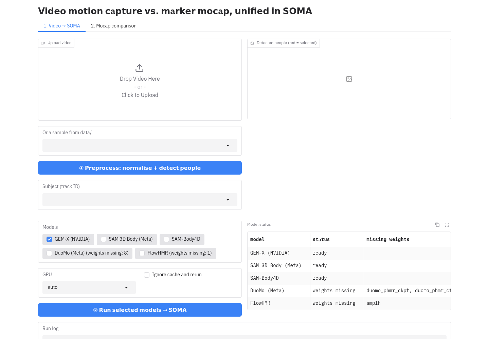
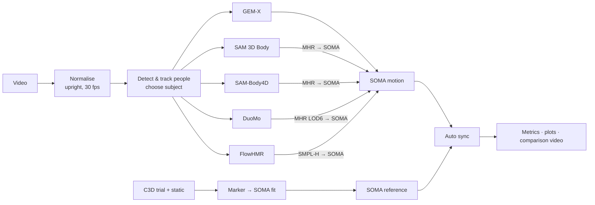

# Video vs. Mocap

**Benchmark monocular video motion-capture models against marker-based motion capture, in one body representation.**

Video-based human motion estimators each speak their own body model (SOMA, MHR, SMPL-H, …), and lab
mocap speaks markers. This tool converts all of them to the [SOMA](https://github.com/NVlabs/SOMA-X)
skeleton, synchronises video and mocap automatically, and reports how far apart they are — numerically
and visually — from a small Gradio web app or the command line.



## Features

- **Five video models, one output format.** GEM-X, SAM 3D Body, SAM-Body4D, DuoMo and FlowHMR all
  produce a `SomaMotion` file: SOMA 77-joint positions (plus parameters where available) on the video clock.
- **Vendor-neutral mocap input.** Any C3D file (Vicon, Qualisys, OptiTrack, Motion Analysis, …): units read
  from the file, vertical axis detected from the data, marker labels resolved through an editable alias table.
- **Marker → SOMA fitting.** A static trial calibrates body shape and marker placement; dynamic trials are
  fitted to the markers and to marker-derived joint centres (bony landmarks weighted above soft-tissue
  markers) with temporal smoothing.
- **Automatic synchronisation.** Video and mocap need not share a clock: the time offset is found by
  cross-correlating joint angles, which do not depend on either system's world frame.
- **Quantitative and qualitative comparison.** MPJPE / PA-MPJPE / W-MPJPE, per-joint error, lower-limb joint
  angle RMSE and correlation, jitter; interactive plots and a side-by-side skeleton video.
- **One environment.** Every model runs on Python 3.12 + PyTorch 2.10 (CUDA 12.8), each in its own process.

## How it works



| Model | Native output | Conversion to SOMA | Upstream |
|---|---|---|---|
| GEM-X | SOMA parameters (world) | none | [NVlabs/GEM-X](https://github.com/NVlabs/GEM-X) |
| SAM 3D Body | MHR, per frame (camera) | SOMA-X pose inversion from MHR | [facebookresearch/sam-3d-body](https://github.com/facebookresearch/sam-3d-body) |
| SAM-Body4D | MHR via SAM 3 masklets (camera) | same MHR converter | [gaomingqi/sam-body4d](https://github.com/gaomingqi/sam-body4d) |
| DuoMo | MHR LOD6 mesh (world) | SOMA-X pose inversion from LOD6 vertices | [facebookresearch/DuoMo](https://github.com/facebookresearch/DuoMo) |
| FlowHMR | SMPL-H parameters (world) | SOMA-X pose inversion from SMPL-H | [flowhmr/flowhmr](https://github.com/flowhmr/flowhmr) |

All models receive the **same normalised clip and the same subject boxes** (and the two MHR models the same
camera intrinsics, estimated once per video), so differences in the results come from the models, not from
preprocessing.

## Requirements

- Linux, NVIDIA GPU with 24 GB memory (SAM-Body4D is the most demanding), driver supporting CUDA 12.8
- 16 GB host RAM minimum (32 GB recommended for SAM-Body4D)
- [uv](https://docs.astral.sh/uv/) and git
- ~40 GB of disk for weights

## Installation

```bash
git clone <this repository> video-vs-mocap
cd video-vs-mocap
bash envs/setup_env.sh          # creates .venv, clones upstream repos at pinned commits, installs packages
```

### Model weights

```bash
.venv/bin/python scripts/download_weights.py --token hf_xxxxxxxx   # everything downloadable
.venv/bin/python scripts/download_weights.py --model gem-x         # or one model
.venv/bin/python scripts/download_weights.py --check               # status report
```

`--token` is your [Hugging Face access token](https://huggingface.co/settings/tokens); without it the script
uses `$HF_TOKEN` or the token stored by `hf auth login`. Gated repositories — request access first:
[facebook/sam-3d-body-dinov3](https://huggingface.co/facebook/sam-3d-body-dinov3) (SAM 3D Body, SAM-Body4D, FlowHMR) and
[facebook/sam3](https://huggingface.co/facebook/sam3) (SAM-Body4D).

Licence-gated body models must be downloaded by hand after registering:

| File | Needed by | Source |
|---|---|---|
| `checkpoints/body_models/smplx/SMPLX_{NEUTRAL,MALE,FEMALE}.npz` | DuoMo | [SMPL-X](https://smpl-x.is.tue.mpg.de) — `models_smplx_v1_1.zip` |
| `checkpoints/body_models/smpl/SMPL_{NEUTRAL,MALE,FEMALE}.pkl` | DuoMo | [SMPL](https://smpl.is.tue.mpg.de) — `SMPL_python_v.1.1.0.zip` (rename `basicmodel_*_lbs_10_207_0_v1.1.0.pkl`) |
| `checkpoints/body_models/smplh/neutral/model.npz` | FlowHMR | [MANO](https://mano.is.tue.mpg.de) — "Extended SMPL+H model" |

Some DuoMo files are only hosted on Google Drive, which rate-limits popular files; if
`download_weights.py` reports *"Too many users have viewed or downloaded this file"*, retry later or download
the file in a browser and place it at the path the script prints.

## Usage

### Web app

```bash
.venv/bin/python app/gradio_app.py            # http://127.0.0.1:7860 plus a public gradio.live link
```

The app creates a public [share link](https://www.gradio.app/guides/sharing-your-app) by default. Anyone with the
link can use the app, including the sample files in `data/`; pass `--no-share` to keep it local
(`--host 0.0.0.0` serves it on the LAN instead).

1. **Video → SOMA** — upload a video, run *preprocess* (normalisation + person tracking), check the
   recommended subject (or pick another track), choose models and run. Each model's `soma.npz` can be
   downloaded and a skeleton preview is rendered.
2. **Mocap comparison** — upload the trial C3D and a static C3D of the same subject, run. The page shows the
   synchronisation result, a metrics table, joint-angle curves, per-joint errors and a comparison video
   (source frame | front view | side view, mocap in grey).

### Command line

```bash
.venv/bin/python scripts/run_video.py  VIDEO.mp4 --models gem-x sam3d-body [--track ID] [--gpu 0]
.venv/bin/python scripts/compare.py    VIDEO.mp4 TRIAL.c3d STATIC.c3d [--sync-ref gem-x] [--up-axis +z]
```

Results are cached under `outputs/videos/<video id>/` (models, comparison report) and `outputs/mocap/`.

## Mocap input

- **Format:** C3D. Unlabelled markers are ignored; subject prefixes (`Subject:LASI`) are stripped.
- **Static trial:** a few seconds of quiet standing with the full marker set (including any medial
  calibration markers). It is used to estimate SOMA body shape and where each marker sits on the body.
- **Marker labels:** anatomical landmarks (ASIS/PSIS, knee and ankle epicondyles/malleoli, toes, heel,
  shoulder, elbow, wrist, head, C7, …) are recognised through the aliases in
  [`configs/markersets.yaml`](configs/markersets.yaml), which covers Plug-in Gait, CAST/IOR-style Qualisys
  labels and common variants. Add your lab's labels there; no code change is needed. Markers that are not
  listed are still used — they are attached to the nearest body segment during calibration.

## Metrics

All metrics use the SOMA joints common to every source (pelvis, spine, neck, head, shoulders, elbows, wrists,
hips, knees, ankles, toes) on the synchronised frames.

| Metric | Definition |
|---|---|
| MPJPE | Mean joint error after aligning the pelvis and one rotation for the whole sequence |
| PA-MPJPE | Mean joint error after a per-frame similarity (Procrustes) alignment |
| W-MPJPE | Mean joint error after one rigid alignment of the whole sequence (global trajectory) |
| Joint angles | Hip flexion/abduction, knee flexion, ankle dorsiflexion, elbow flexion from joint positions: RMSE, bias, bias-free RMSE, Pearson *r*, range of motion |
| Jitter / accel. error | Mean joint acceleration of the model, and its difference to mocap (m/s²) |

**Synchronisation** uses the convention `t_video = t_mocap + offset`. Each model's offset is estimated
independently; the reported common offset maximises the average correlation curve over all models, so every
model is scored on the same frames.

## Output format

`soma.npz` (one per model, and one per mocap trial) is a `vvm.soma.motion.SomaMotion`:

| Key | Shape | Description |
|---|---|---|
| `times` | `[T]` | seconds on the source clock |
| `joints` | `[T, 77, 3]` | SOMA public joints, metres, right-handed Y-up |
| `joint_names` | `[77]` | SOMA joint names |
| `valid` | `[T]` | frame has a prediction / enough markers |
| `poses`, `transl`, `identity`, `scale_params` | optional | SOMA parameters when the source provides them |
| `frame` | – | `world` or `camera` (camera axes, Y-up) |
| `meta` | – | JSON: runtime, conversion error, settings |

```python
from vvm.soma.motion import SomaMotion
m = SomaMotion.load("outputs/videos/<id>/models/gem-x/soma.npz")
knee = m.joint("LeftShin")        # [T, 3]
```

## Project structure

```
app/gradio_app.py         web UI (wires widgets to vvm.pipeline)
scripts/                  download_weights.py, run_video.py, compare.py
configs/markersets.yaml   marker-label aliases
envs/                     setup_env.sh, requirements.txt
vvm/
  pipeline.py             end-to-end steps shared by the UI and the CLI
  paths.py, weights.py    directory layout and the single weight manifest
  video/                  normalisation, frame I/O, person tracking and subject selection
  models/                 VideoModel interface, registry + subprocess runner, one adapter per model
  soma/                   SomaMotion format, SOMA body (FK), converters (MHR, MHR-LOD6, SMPL family)
  mocap/                  C3D loader, landmarks and joint centres, marker → SOMA fitting
  sync/                   automatic time alignment
  eval/                   joint angles and metrics
  viz/                    colours, Plotly figures, comparison video
```

### Adding a model

Create `vvm/models/<name>.py` with a `VideoModel` subclass whose `run(video, out_dir, device)` returns a
`SomaMotion` (use a converter from `vvm/soma/convert.py` if the model outputs MHR or SMPL-family bodies),
declare its weights in `vvm/weights.py`, and add one line to `REGISTRY` in `vvm/models/__init__.py`.
The UI, CLI, synchronisation and evaluation pick it up automatically.

## Limitations

- GEM-X, SAM 3D Body and SAM-Body4D have been tested end to end. The DuoMo and FlowHMR adapters are
  implemented but not yet validated, because their licence-gated body models were not available during
  development.
- Single subject per run; the subject is chosen once and the same boxes are given to every model.
- Synchronisation needs joint motion in the mocap trial. Trials without movement (e.g. quiet standing) are
  reported as not synchronisable, and their offset is arbitrary.
- The camera is assumed static (lab setting) for GEM-X, DuoMo and FlowHMR.
- SAM-Body4D runs with 8 frames per batch to fit a 24 GB GPU (upstream: 64). Its occlusion completion and
  temporal smoothing work per batch, so its camera depth jumps at batch boundaries, which inflates its
  W-MPJPE and jitter; pose metrics (PA-MPJPE, joint angles) are much less affected. Raise `BATCH` in
  [`vvm/models/sam_body4d.py`](vvm/models/sam_body4d.py) on larger GPUs.
- DuoMo outputs vertices only, so its SOMA conversion uses the mean MHR body shape: joint angles are
  comparable, absolute bone lengths are not.
- Upstream code is used as released, except for small bug fixes kept as patches in
  [`envs/patches/`](envs/patches) and applied by `setup_env.sh`; adapters otherwise change behaviour only from
  the outside (input injection, output capture).

## Acknowledgements

This project builds on [SOMA-X](https://github.com/NVlabs/SOMA-X), [GEM-X](https://github.com/NVlabs/GEM-X),
[SAM 3D Body](https://github.com/facebookresearch/sam-3d-body), [SAM-Body4D](https://github.com/gaomingqi/sam-body4d),
[DuoMo](https://github.com/facebookresearch/DuoMo), [FlowHMR](https://github.com/flowhmr/flowhmr),
[MHR](https://github.com/facebookresearch/MHR) and [ezc3d](https://github.com/pyomeca/ezc3d). Please cite the
original papers when you use their models.

## License

The code in this repository is released under the [MIT License](LICENSE). It does not include or
redistribute any model code or weights; those keep their own licenses — notably the SAM License (SAM 3,
SAM 3D Body), non-commercial research licenses (DuoMo, FlowHMR weights) and the SMPL-family model
licenses — which apply when you download and run them.
